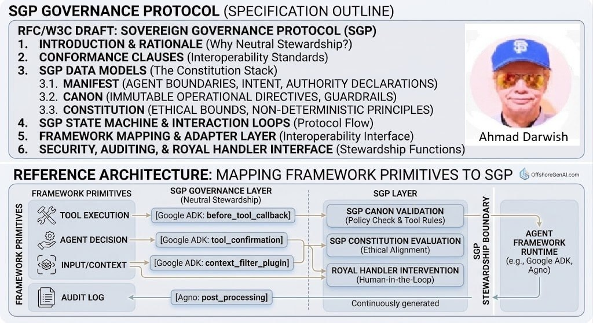
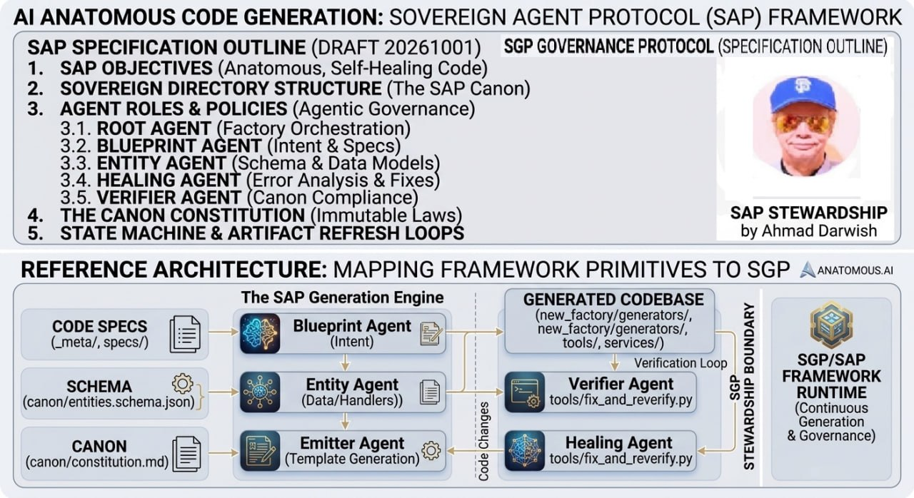

I was blessed to innovate the below after the horror stories of agents messing up private and financial profiles

This infographic outlines the **Sovereign Governance Protocol (SGP)**, a technical framework designed to establish standardized governance, safety guardrails, and ethical oversight for autonomous AI agent systems.
---

### Key Components

#### 1. Specification Outline (Top Section)
Defines the RFC/W3C draft structure for the SGP framework:

* **Introduction & Rationale:** Covers the need for neutral stewardship in AI operations.
* **Conformance Clauses:** Sets standard rules to ensure cross-platform interoperability.
* **SGP Data Models (The Constitution Stack):**
* **Manifest:** Defines agent boundaries, intent, and authority declarations.
* **Canon:** Establishes immutable operational directives and guardrails.
* **Constitution:** Outlines high-level ethical bounds and non-deterministic principles.
* **State Machine & Interaction Loops:** Details operational protocol flows.
* **Framework Mapping & Adapter Layer:** Specifies interfaces for framework interoperability.
* **Security, Auditing, & Governance:** Details stewardship, auditing, and human-in-the-loop functions.
---

#### 2. Reference Architecture Flow (Bottom Section)
Illustrates how core framework primitives (e.g., Google ADK, Agno) map into the SGP Governance Layer:

| Framework Primitive | SGP Governance Hook | SGP Validation Layer |
| :--- | :--- | :--- |
| **Tool Execution** | `[Google ADK: before_tool_callback]` | **SGP Canon Validation** (Policy checks & tool rules) |
| **Agent Decision** | `[Google ADK: tool_confirmation]` | **SGP Constitution Evaluation** (Ethical alignment) |
| **Input / Context** | `[Google ADK: context_filter_plugin]` | **Royal Handler Intervention** (Human-in-the-loop supervision) |
| **Audit Log** | `[Agno: post_processing]` | **Continuously Generated Log** across the SGP stewardship boundary |
---

### Core Value Proposition
* **Interoperable Safety:** Standardizes how different AI frameworks validate actions before execution.
* **Policy Enforcement:** Verifies that agent actions comply with hard rules (Canon) and ethical guidelines (Constitution).
* **Human Oversight:** Supports "Human-in-the-Loop" intervention to intercept or review decisions.
* **Traceability:** Maintains continuous audit logging across framework runtimes.
